<picture>
  <source media="(prefers-color-scheme: dark)" srcset="assets/hero-dark.svg" />
  
</picture>

 

<picture>
  <source media="(prefers-color-scheme: dark)" srcset="assets/bento-dark.svg" />
  
</picture>

 
 

  <picture>
    <source media="(prefers-color-scheme: dark)" srcset="https://skillicons.dev/icons?i=ts%2Creact%2Cnextjs%2Cvite%2Ctailwind%2Cnodejs%2Cgo%2Cpy%2Cpostgres%2Csqlite%2Ccloudflare%2Cgit&theme=dark" />
    
  </picture>

  <a href="https://x.com/_irfanzahir">X</a> &nbsp;·&nbsp;
  <a href="https://t.me/irfanzahir">Telegram</a> &nbsp;·&nbsp;
  <a href="https://discord.com/users/616791602702057483">Discord</a>
   
  

